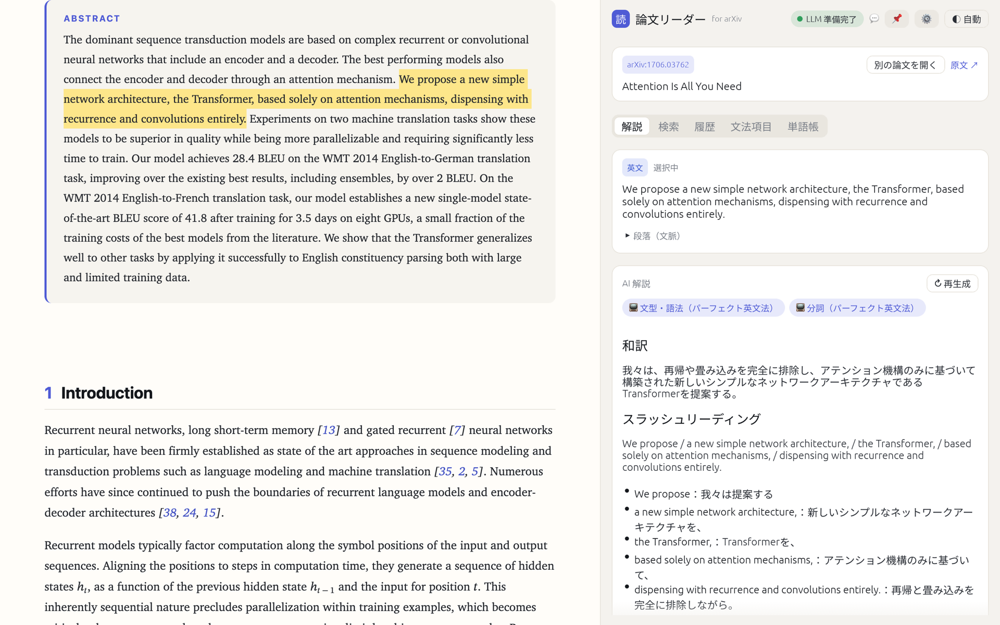
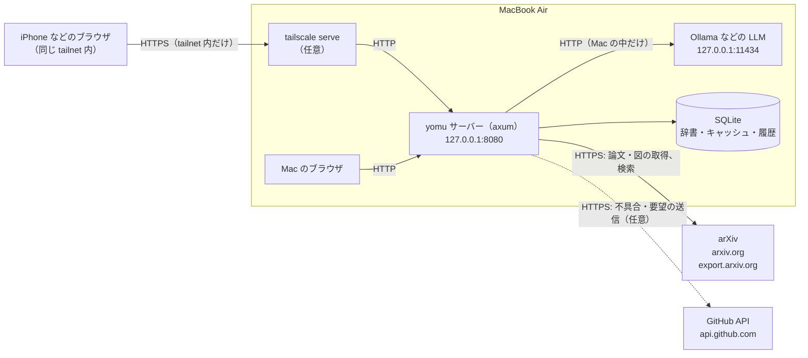

# yomu

**英語が苦手な人のための英語論文（arXiv）リーダー**です。

単語をダブルクリックすると訳が出ます。英文を選んで <kbd>E</kbd> を押すと、和訳・文の構造・文法の解説が、論文の横に日本語で表示されます。
AI は手元の MacBook Air で動かすので、API キーや利用料は必要ありません。



<sub>表示している論文: Vaswani et al., "Attention Is All You Need"（[arXiv:1706.03762](https://arxiv.org/abs/1706.03762)）。解説はローカル LLM（gemma4:e4b-it-qat）が生成したものです。</sub>

## できること

全文を翻訳するのではなく、原文を読みながら、わからない所だけを調べる使い方を想定しています。

- **単語を調べる** — 手元の辞書（約 4.6 万語）で引きます。辞書にない語は、AI が文脈に合わせて訳します（「AI 訳」と表示）
- **英文の解説** — 和訳、文法タグ、文の構造・文法ポイント・語句の順に表示します。和訳は約 1 秒で出はじめます（M2 / 16GB で計測）
- **スラッシュリーディング** — 英文を意味のまとまりで区切り、語順どおりに訳します
- **学校で習う文法用語** — 「分詞構文」「関係副詞」「第5文型」などの呼び方で解説します。
- **記録** — 単語帳、調べた履歴、読んだ位置を残す付箋があります。解説は保存されるので、2 回目はすぐに表示されます
- **iPhone でも読める** — [Tailscale](https://tailscale.com) を使うと、iPhone から自分の Mac につないで読めます

AI の解説や訳には、誤りが含まれることがあります。

## 動く仕組み

サーバー、辞書、AI、データベースは、すべて MacBook Air（M2 / 16GB）1 台で動かします。
調べた単語や英文を、クラウドの AI に送ることはありません。
論文は arXiv から取得して保存するので、2 回目からは保存したものを表示します。
不具合や要望を GitHub に送る機能もあります。使うかどうかは任意で、送る前に内容を確認できます。

Rust で書いていて、サーバーは axum、解説画面は egui（WebAssembly）です。

### ネットワーク構成



- サーバーと LLM は `127.0.0.1` で待ち受けます。ほかの端末からつなぐ場合は `tailscale serve` を使い、インターネットには公開しません
- LLM は、ほかの端末に直接公開しません。解説の依頼は、必ず yomu サーバーを経由します
- ブラウザは arXiv に直接アクセスせず、論文と図は yomu サーバーから受け取ります（「原文」や本文中の外部リンクを開く場合を除く）
- この図は、アプリを使うときの通信です。セットアップ、[自動更新](docs/operations.md#自動更新github-の-main-に入ったら反映する)、[実験モード](docs/webllm.md)の準備では、別に外部からダウンロードします

## はじめる

必要なもの: Mac、[rustup](https://rustup.rs)、[Homebrew](https://brew.sh)、モデル用の空き容量（約 6GB）

```sh
git clone https://github.com/Baker-Tanaka/yomu-server.git
cd yomu-server

# 必要なツール
brew install trunk ollama
ollama serve                      # このターミナルは開いたままにして、続きは別のターミナルで
```

```sh
# 別のターミナルで、yomu-server に移動してから
ollama pull gemma4:e4b-it-qat

# 辞書
git clone --depth 1 https://github.com/kujirahand/EJDict data/EJDict
cargo run -p import-dict --release

# ビルドして起動
(cd crates/web && trunk build)
cargo run -p paper-reader-server
```

http://127.0.0.1:8080 を開き、`https://arxiv.org/abs/1706.03762` を貼って「開く」。
例の "Attention Is All You Need" が開きます。読めるのは、arXiv に HTML 版がある論文です。

## ドキュメント

| ドキュメント | 内容 |
| --- | --- |
| [使い方](docs/usage.md) | 操作と機能のすべて |
| [セットアップ](docs/setup.md) | 必要な環境、辞書、モデルの選び方、設定 |
| [常時稼働](docs/operations.md) | 自動起動・自動更新、iPhone から使う |
| [文法タグ](docs/grammar.md) | 文法項目の定義と、判定の仕組み |
| [不具合・要望の送信](docs/feedback.md) | アプリから GitHub の Issue を作る |
| [実験モード](docs/webllm.md) | iPhone などの GPU で LLM を動かす |
| [API](docs/api.md) | サーバーの API |
| [開発](docs/development.md) | 構成、テスト、Issue からの開発 |

不具合や要望は [Issue](https://github.com/Baker-Tanaka/yomu-server/issues) で受け付けています。

## ライセンス

ソースコードは [MIT License](LICENSE) です。
辞書の [EJDict-hand](https://github.com/kujirahand/EJDict) はパブリックドメイン（CC0 1.0）、
フォントの [Noto Sans JP](https://github.com/notofonts/noto-cjk) は SIL Open Font License 1.1 です。
